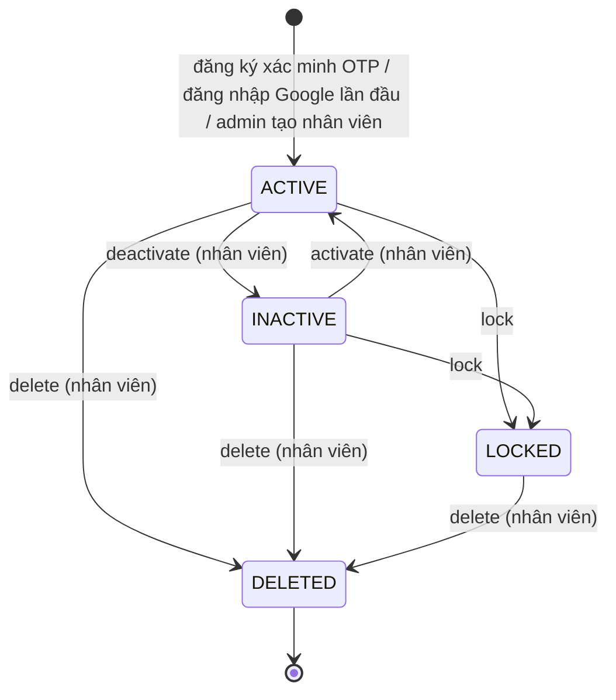

# Account Lifecycle

Nguồn: Chương 3.3 — Hình 27, tr. 60.

Report thể hiện các trạng thái theo ý nghĩa: đã tạo, đã xác nhận/kích hoạt, bị khóa, bị hủy. Code (`AccountStatus`, `AccountLocker`, `AccountStateChanger`) triển khai bốn trạng thái `ACTIVE`, `INACTIVE`, `LOCKED`, `DELETED`.

- Không có trạng thái "chờ xác nhận" trong bảng `accounts`: dữ liệu đăng ký chờ OTP nằm tạm trong Redis (10 phút) và tài khoản chỉ được tạo, ở `ACTIVE`, sau khi OTP đúng.
- `LOCKED` là trạng thái một chiều: hệ thống không có thao tác mở khóa; chỉ xóa (nhân viên) mới đi tiếp được. Khóa tài khoản đã `LOCKED` hoặc `DELETED` bị từ chối.
- `INACTIVE` chỉ vào và ra bằng `deactivate`/`activate`; `activate` không áp dụng cho `LOCKED` hay `DELETED`.
- `DELETED` là xóa mềm: bản ghi vẫn nằm trong bảng, email và số điện thoại vẫn bị chiếm, không có đường quay lại.
- Khóa khách hàng và nhân viên dùng chung `AccountLocker`; vô hiệu hóa và xóa dùng `AccountStateChanger`. Chuyển sang `LOCKED`, `INACTIVE` hoặc `DELETED` đều ghi marker thu hồi token, nên access/refresh token đã phát hành bị từ chối ngay; nếu ghi marker lỗi thì thay đổi trạng thái được rollback.
- Chỉ tài khoản `ACTIVE` đăng nhập, refresh token, đặt lại mật khẩu hoặc đổi mật khẩu được.
- Khách hàng chỉ có thao tác khóa; vô hiệu hóa, kích hoạt và xóa chỉ có cho nhân viên (`/employees/{accountId}/...`).
