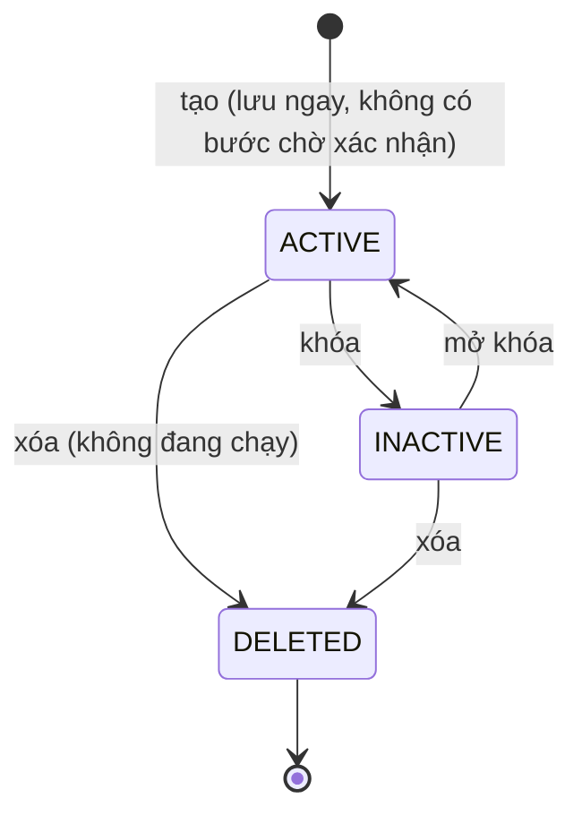

# Discount Lifecycle

Nguồn: Chương 3.3 — Hình 26, tr. 59.

Report mô tả vòng đời theo ý nghĩa: khởi tạo, xác nhận, đang diễn ra, đã đóng, đã hủy. Code không lưu từng bước đó mà lưu một trạng thái nhỏ hơn và tính phần còn lại từ thời gian.

Trạng thái lưu (`discounts.status`): `ACTIVE`, `INACTIVE` (khóa), `DELETED` (xóa mềm). Trạng thái hiển thị `DiscountState` trong danh sách là kết quả ghép với thời gian hiệu lực, tính tại thời điểm xem:

| Hiển thị | Điều kiện |
|---|---|
| `LOCKED` | status là `INACTIVE` |
| `SCHEDULED` | `ACTIVE` và hiện tại trước `start_at` |
| `RUNNING` | `ACTIVE` và `start_at` <= hiện tại < `end_at` |
| `EXPIRED` | `ACTIVE` và hiện tại >= `end_at` |

- Không có tác vụ chạy nền: hết hạn là suy ra từ `end_at` lúc truy vấn, nên không có bước "kích hoạt" hay "đóng" riêng. Promotion Service kiểm tra hiệu lực mỗi lần tính giá đơn.
- Chỉ discount `RUNNING` mới được áp; discount `SCHEDULED` tự bắt đầu khi đến `start_at`.
- Discount `RUNNING` không xóa trực tiếp được; phải khóa trước (`DISCOUNT_RUNNING`).
- `DELETED` là cuối. Đơn đã đặt giữ nguyên số tiền giảm đã tính; code của discount đã xóa dùng lại được.
