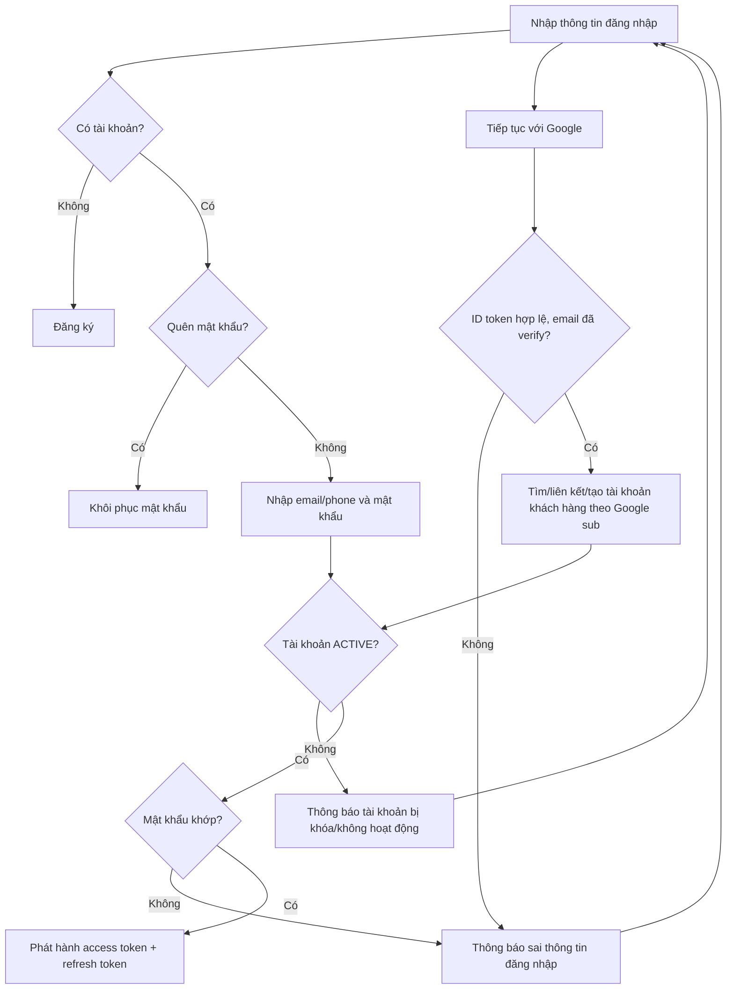

# Login Flow

Nguồn: Chương 3.4 — Hình 29, tr. 61.

Identity đăng nhập được chốt tại `accounts.email` hoặc `accounts.phone`; không hỗ trợ username riêng.

Trạng thái tài khoản được kiểm tra trước mật khẩu. Email/số điện thoại không tồn tại và mật khẩu sai cho cùng một thông báo. Khi access token hết hạn, client đổi refresh token lấy cặp token mới (`POST /auth/refresh-token`); refresh token bị thu hồi bởi đăng xuất hoặc khóa tài khoản thì không dùng được nữa.
