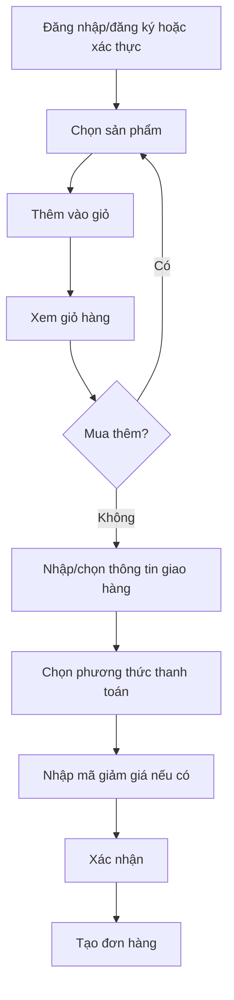
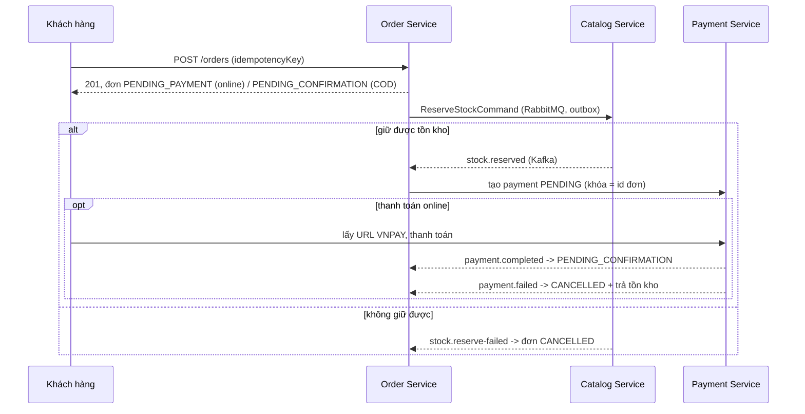

# Order Flow

Nguồn: Chương 3.4 — Hình 30, tr. 61 và UC đặt hàng tr. 57.

Giỏ hàng chỉ có cho khách đã đăng nhập, nên bước đầu của luồng bắt buộc là đăng nhập. Khi bấm xác nhận, hệ thống gộp bước "Tạo đơn hàng" thành một transaction ở Order Service (kiểm tra giỏ, snapshot giá/địa chỉ/phí giao, áp discount, lưu đơn, xóa các dòng giỏ, ghi lệnh giữ tồn kho vào outbox); client gửi kèm `idempotencyKey` nên gửi lại không tạo đơn thứ hai.

Sau bước tạo đơn, việc còn lại chạy bất đồng bộ qua saga:

- Online: order `PENDING_PAYMENT` → payment `PAID` → order `PENDING_CONFIRMATION`. Payment thất bại thì đơn bị hủy và trả tồn kho, không ở lại `PENDING_PAYMENT`.
- COD: order `PENDING_CONFIRMATION` → nhân viên xác nhận → `CONFIRMED`.
- Cả hai nhánh tiếp tục `SHIPPING` → giao thành công → `COMPLETED`.
- Khách hủy được khi đơn còn `PENDING_PAYMENT`/`PENDING_CONFIRMATION`.
