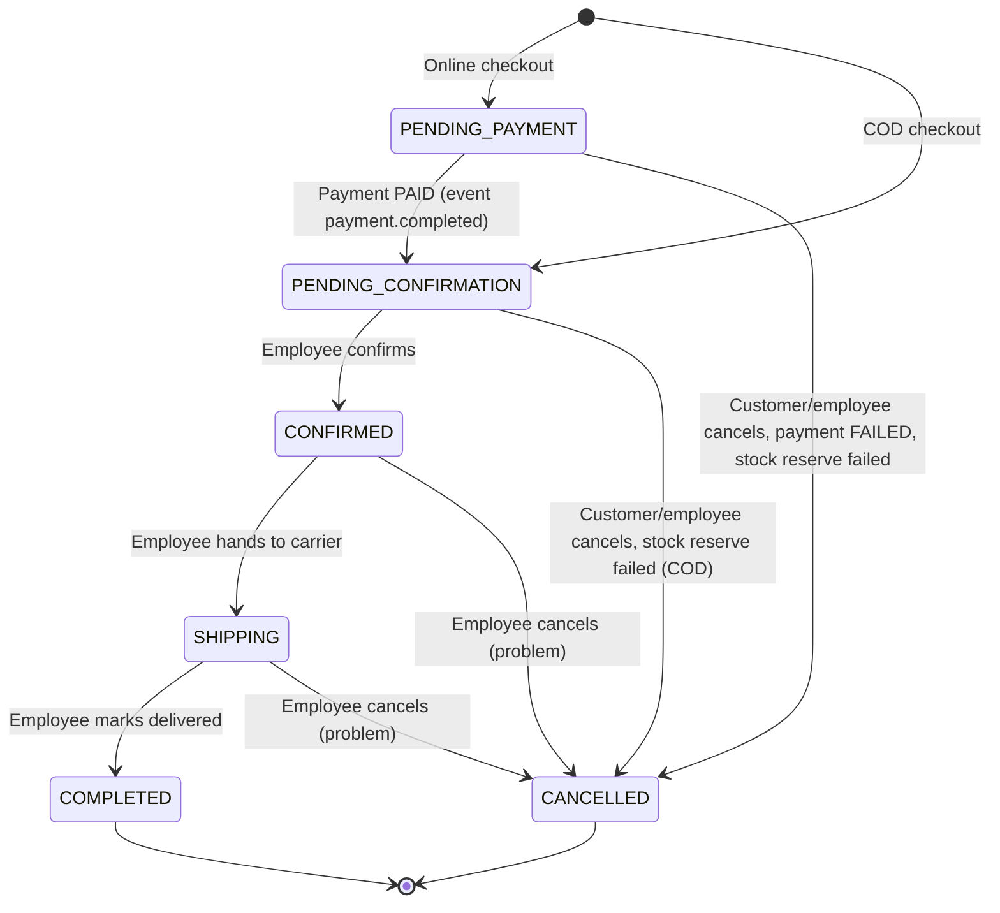

# Order Lifecycle

Order status và payment status là hai state machine độc lập.

## Status definitions

| Status | Ý nghĩa |
|---|---|
| `PENDING_PAYMENT` | Đơn online đã tạo, đang chờ thanh toán thành công; không tự hết hạn, ở lại trạng thái này tới khi thanh toán xong, thất bại hoặc bị hủy. |
| `PENDING_CONFIRMATION` | Đã đủ điều kiện thanh toán hoặc là COD, đang chờ nhân viên xác nhận. |
| `CONFIRMED` | Nhân viên đã xác nhận đơn. |
| `SHIPPING` | Đơn đang được giao. |
| `COMPLETED` | Đã giao thành công; thời điểm chuyển sang `COMPLETED` được lưu là `delivered_at` và là ngày hóa đơn. Với COD, nhân viên ghi nhận payment `PAID` riêng khi thu tiền, hệ thống không bắt buộc phải làm trước khi hoàn tất đơn. |
| `CANCELLED` | Đơn bị hủy. Khách chỉ tự hủy được ở `PENDING_PAYMENT`/`PENDING_CONFIRMATION`; nhân viên hủy thêm được ở `CONFIRMED`/`SHIPPING` và phải ghi lý do; hệ thống tự hủy khi thanh toán online thất bại (trả tồn kho) hoặc Catalog không giữ được tồn kho. Hủy đơn trả tồn kho và hủy payment `PENDING`; payment đã `PAID` giữ nguyên để hoàn tiền thủ công. Trạng thái cuối. |

Order không có trạng thái `DELETED`.
