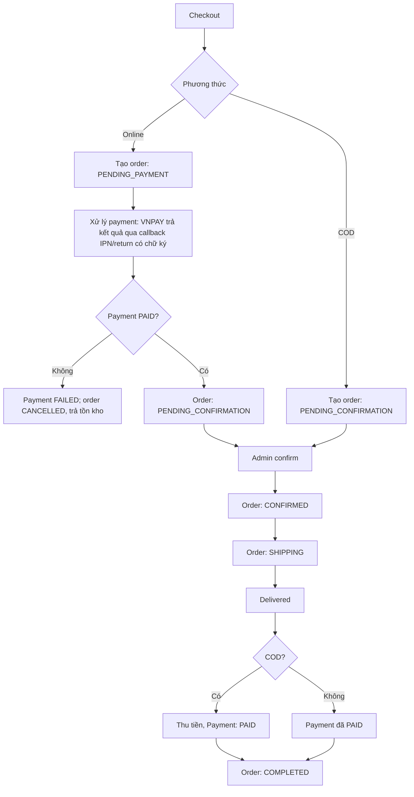

# Payment Flow

Nguồn: Chương 3.4 — Hình 31, tr. 62; state diagram thanh toán tr. 60.

Checkout có hai nhánh chính: COD và thanh toán online. Hai nhánh chỉ khác thời điểm ghi nhận `Payment.PAID` và order status.

Thứ tự trong thực tế hơi khác sơ đồ ở một điểm: đơn chuyển `COMPLETED` do nhân viên đẩy trạng thái và không kiểm tra payment; với COD nhân viên đánh dấu payment `PAID` bằng thao tác riêng (UC-ADM-PAY-002), có thể trước hoặc sau khi hoàn tất đơn.
