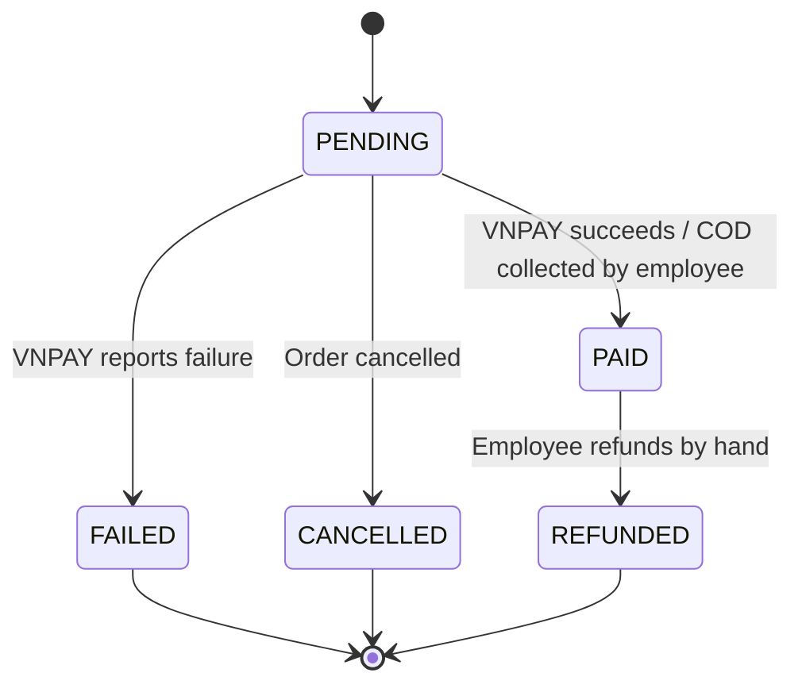

# Payment Lifecycle

Payment status được quản lý độc lập với order status.

Payment status không tự động thay thế order status. Với online, `PAID` (sự kiện `payment.completed`) cho phép order đi từ `PENDING_PAYMENT` sang `PENDING_CONFIRMATION`; `FAILED` (sự kiện `payment.failed`) làm order bị hủy và trả tồn kho. Với COD, order có thể hoàn tất giao hàng trước khi payment chuyển sang `PAID`.

- `CANCELLED`: đơn bị hủy trước khi payment được giải quyết; Payment Service tự chuyển khi nhận `order.cancelled`. Payment đã `PAID` không bị đổi, nhân viên hoàn tiền ngoài hệ thống rồi đánh dấu `REFUNDED`.
- `REFUNDED` chỉ đến từ `PAID` bằng tay nhân viên; hệ thống không hoàn tiền qua cổng.
- Một đơn có thể có nhiều payment attempt, nhưng tối đa một payment `PAID`.
- Hiện không có hết hạn tự động: payment `PENDING` không tự sang `FAILED` theo thời gian.
