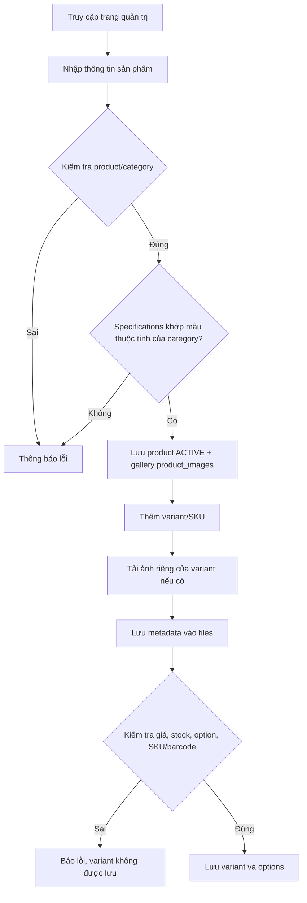

# Product Creation Flow

Nguồn: Chương 3.4 — Hình 32, tr. 62.

Tạo sản phẩm và thêm variant là hai thao tác riêng, mỗi thao tác một transaction. Variant lỗi không làm mất sản phẩm đã lưu ở bước trước, mà sản phẩm giữ nguyên chưa có variant. Sản phẩm không có variant `ACTIVE` chưa hiện ở trang công khai nên nhân viên cần thêm ít nhất một variant. Gallery (ảnh chính, tối đa một) thuộc cấp product, được lưu cùng lúc với product; ảnh riêng của variant lưu cùng variant. Ảnh được tải lên Media Service trước và product/variant chỉ giữ `fileId`.

Sau khi lưu, Debezium đọc thay đổi và sync-service dựng lại document tìm kiếm của sản phẩm (xem UC-CAT-003), nên sản phẩm mới tìm được sau vài giây.
