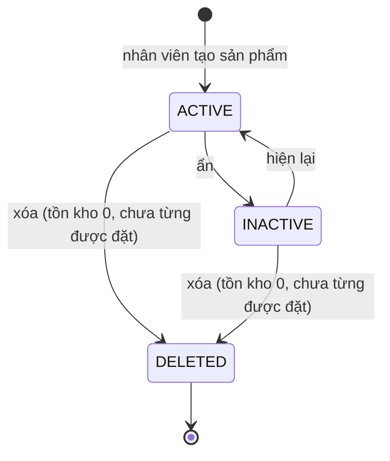

# Product Lifecycle

Nguồn: Chương 3.3 — Hình 24, tr. 58.

Report mô tả các trạng thái/khái niệm chính: đã tạo, đang bán, ngừng trưng bày và hết hàng. Thiết kế mới tách trạng thái hiển thị khỏi stock tổng `product_variants.quantity`; MVP không model reservation, backorder hoặc stock movement.

- Sản phẩm và variant cùng dùng `CatalogStatus`: `ACTIVE`, `INACTIVE`, `DELETED`. Một sản phẩm bán được khi chính nó và variant đều `ACTIVE`; ẩn sản phẩm không đổi trạng thái variant của nó.
- "Hết hàng" không phải trạng thái: là variant `ACTIVE` có `quantity = 0`. Sản phẩm hết hàng vẫn được liệt kê và xem chi tiết, nhưng không thêm vào giỏ hay đặt được. Cờ `inStock` của tìm kiếm và tổng tồn kho của danh sách suy ra từ `quantity`.
- Tồn kho giảm khi đơn được giữ chỗ (đặt hàng thành công) và tăng lại khi đơn bị hủy hoặc thanh toán thất bại; không có bảng lịch sử xuất nhập kho.
- Xóa là xóa mềm cả sản phẩm lẫn các variant; sản phẩm đã có tồn kho hoặc từng được đặt chỉ ẩn được. Bản ghi `DELETED` giữ lại để đơn cũ vẫn tham chiếu, và SKU, barcode, `seo_name` được dùng lại.
- Ngưỡng tồn kho thấp để cảnh báo ở dashboard cấu hình trong Catalog (mặc định 5).
