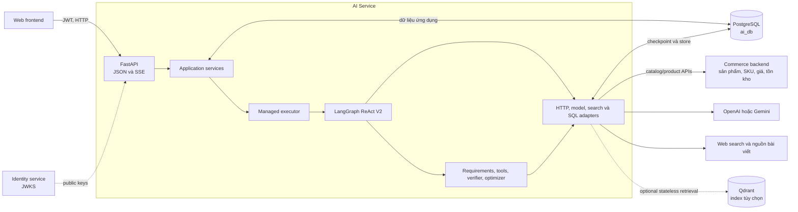
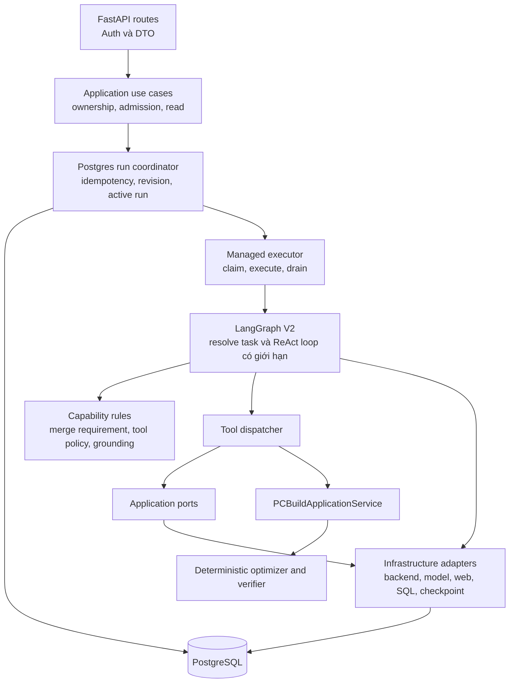
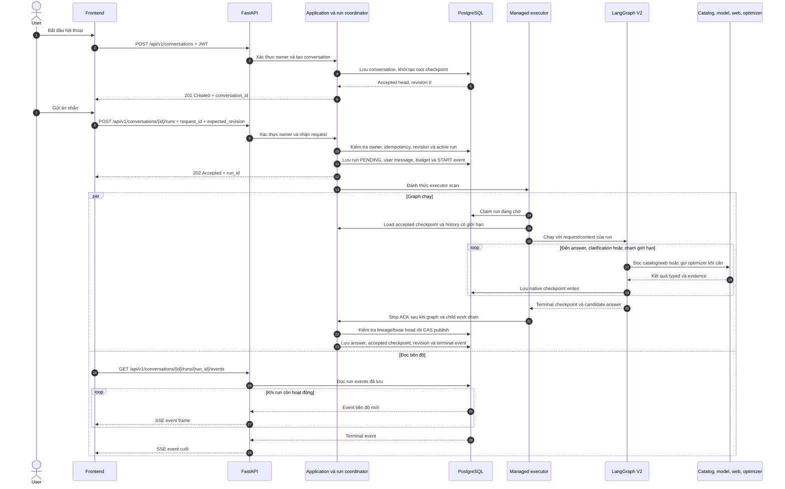
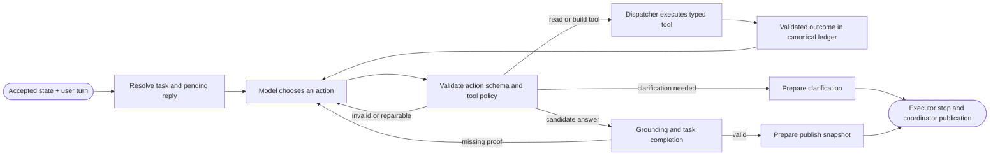

# Kiến trúc AI Service

AI Service nhận yêu cầu, tra cứu catalog và tư vấn hoặc build PC. Backend thương
mại sở hữu dữ liệu sản phẩm/tồn kho; AI Service sở hữu hội thoại và trạng thái đã
chấp nhận; optimizer xếp hạng cấu hình theo thuật toán xác định.

## Ranh giới hệ thống



Hai nhánh PostgreSQL có chủ sở hữu riêng: bảng ứng dụng lưu conversation, run,
message và event; LangGraph checkpointer lưu checkpoint thực thi. Qdrant là index
phái sinh tùy chọn, không quyết định visibility/giá/tồn kho hiện tại và không lưu
conversation của Stateful ReAct V2.

| Hệ thống | Sở hữu | AI Service dùng để |
| --- | --- | --- |
| Identity service | Account và signing keys | Xác minh access token qua JWKS |
| Commerce backend | Catalog active, SKU, giá và tồn kho | Tra cứu sản phẩm và dữ liệu linh kiện |
| AI Service | Conversation, run, requirements và kết quả đã chấp nhận | Điều phối hội thoại và API AI |
| Model provider | Model inference | Hiểu yêu cầu, chọn action được phép, giải thích evidence |
| Web sources | Nội dung trang ngoài | Bổ sung thông tin có nguồn và trạng thái trích xuất |
| PostgreSQL | Bản ghi AI và checkpoint LangGraph | Lưu state, execution và tiến độ bền vững |

AI Service gọi backend qua HTTP adapter, không đọc trực tiếp database thương mại.
Model chỉ đề xuất action; application xác minh trước khi áp dụng requirement hay
công bố state hội thoại.

## Các thành phần bên trong



| Thành phần | Trách nhiệm | Không sở hữu |
| --- | --- | --- |
| API | Xác thực, validate DTO và map envelope `{data, message, errors}` | Vòng đời graph hoặc quyết định nghiệp vụ |
| Application | Kiểm tra ownership, nhận run, idempotency/revision và publication | Prompt riêng của provider hoặc phép tính optimizer |
| Requirements | Resolve tham chiếu, merge yêu cầu, compile và verify | Tự thêm điều người dùng chưa yêu cầu |
| ReAct capability | Định nghĩa action/tool, policy theo state, outcome và quy tắc answer | Ghi DB hoặc tự công bố state |
| LangGraph | Chạy flow hội thoại có giới hạn và checkpoint state | Nghiệp vụ thương mại hoặc sự thật catalog |
| Tool dispatcher | Validate và gọi action typed qua service/port | Bỏ qua canonical lookup với ID do model đưa ra |
| PC build service/optimizer | Tạo, xếp hạng cấu hình từ input và policy | Gọi network, database hay model |
| Infrastructure | Nối framework, database, HTTP và provider adapters | Sở hữu thêm một bản business rule |

Capability dùng contract và port. Infrastructure gắn implementation khi startup;
graph điều phối, còn requirement và optimizer quyết định kết quả nghiệp vụ.

| Công nghệ | Vai trò |
| --- | --- |
| FastAPI | HTTP routes, OpenAPI và application lifespan |
| Pydantic | Validate request, tool, result và public-view contract |
| LangGraph | Điều phối flow stateful có giới hạn và checkpoint graph state |
| LangChain model adapters | Giao tiếp structured-output/tool protocol của từng provider |
| PostgreSQL | Lưu bản ghi ứng dụng và native graph checkpoint |

Request path chỉ có một graph runtime là LangGraph; không dùng PydanticAI.

## Một lượt hội thoại

Frontend tạo conversation một lần, sau đó gửi mỗi lượt user thành một run. Khi
tạo conversation, service ghi native root checkpoint và đặt nó làm accepted head
ban đầu. Run được ghi bền vững rồi trả `202`; HTTP handler không sở hữu graph task.



SSE chỉ đọc run events đã lưu. Ngắt kết nối không dừng executor; muốn hủy phải gọi
cancel endpoint. V2 `DELTA` chứa answer text đã validate, không chứa token thô của
provider. Xem [HTTP/SSE contract](../05-api/stateful-chat-v2.md). Có thể đọc trạng
thái bằng `GET /api/v1/conversations/{id}/runs/{run_id}`.

## Bên trong graph



Graph không ép mọi câu hỏi đi qua cùng một chuỗi tool. Nó chỉ expose tool phù hợp
với task và state hiện tại. Với yêu cầu build, application compile canonical
requirements thành optimizer input; optimizer xác định các cấu hình xếp hạng;
verifier riêng đối chiếu kết quả với yêu cầu gốc. Câu hỏi sản phẩm có thể chỉ cần
catalog evidence, không chạy optimizer.

`tool ledger` là execution record; model messages được dựng từ typed tool outcomes.
Model có thể diễn giải kết quả, nhưng application chỉ publish sau khi xác nhận đủ
evidence và task đã hoàn thành. Xem [agent/tools](../04-ai/agent-tools.md) và
[requirements](../04-ai/requirements.md).

## Conversation, run và checkpoint

Mỗi conversation ánh xạ vào một LangGraph `thread_id` ổn định. Nhiều run nối tiếp
checkpoint trên cùng thread. Application giữ accepted head riêng:

```text
Application tables                         LangGraph checkpointer
───────────────────                         ─────────────────────
conversation.revision                      thread_id = conversation_id
conversation.accepted_checkpoint_id ─────► cp-A → cp-B → cp-C
agent_runs.base/final checkpoint refs       accepted     working/orphan
published messages and run events
```

`accepted_checkpoint_id` trỏ tới state đã publish. Checkpoint mới hơn có thể thuộc
run chưa xong hoặc execution mồ côi; “checkpoint mới nhất” không tự trở thành state
công khai hay base của lượt chat kế tiếp.

| Bản ghi | Nguồn dữ liệu chuẩn cho |
| --- | --- |
| `conversations` | Owner, revision, active run, accepted checkpoint ref |
| `agent_runs` | Request identity, base/final ref, attempt và execution status |
| `conversation_messages` | User turn đã nhận và assistant reply đã publish |
| `agent_run_events` | Tiến độ bền vững và terminal event cho SSE |
| `agent_call_budgets` / `agent_call_attempts` | Giới hạn model/tool I/O bền vững theo run |
| LangGraph checkpointer | Graph state, checkpoint lineage và pending writes |

Application tables và native saver cùng dùng PostgreSQL nhưng có chủ sở hữu, write
path riêng. Application không sửa trực tiếp bảng nội bộ LangGraph. Xem
[stateful schema](../03-data/ai-stateful-schema.md).

## Vòng đời và an toàn execution

Managed executor hiện chạy cùng process AI Service trong FastAPI lifespan.
PostgreSQL lưu run đang chờ và điều phối claim; hiện chưa có worker service hay
message broker riêng.

```text
Startup: kiểm tra migration và saver → mở clients → chạy managed executor
Request: lưu run → executor claim → graph/checkpointer xử lý
Publish: graph drain → executor stop ACK → kiểm tra lineage → CAS accepted head
Shutdown: drain execution → đóng model, HTTP client và DB resources
```

Các invariant dưới đây bảo vệ thread dùng chung:

1. Mỗi conversation chỉ có tối đa một execution sở hữu thread tại một thời điểm.
2. Run status hoặc lease hết hạn không chứng minh graph cũ đã dừng.
3. Chỉ stop evidence đáng tin cậy mới cho phép coordinator nhả thread.
4. Trước publication, kiểm tra checkpoint lineage và base revision/head rồi mới
   CAS accepted checkpoint.
5. Run lỗi/hủy có thể để lại checkpoint; checkpoint đó không thành accepted state.

Executor drain graph work trước khi ghi stop evidence. Nếu không lưu được evidence,
conversation vẫn bận để tránh takeover chỉ dựa vào heartbeat timeout. Xem
[state và recovery](../04-ai/context-management.md).

## Bắt đầu từ mã nguồn

```text
ai_service/
├── api/                    HTTP routes, auth dependencies, SSE encoding
├── application/            Use case và port
├── capabilities/
│   ├── assistant/          Requirements, ReAct actions/tools, grounding/publication
│   └── pc_builder/         Build service, compatibility, optimizer và scoring
└── infrastructure/
    ├── execution/          Managed executor và tạo graph cho từng run
    ├── graph/              LangGraph flow và checkpoint adapter
    ├── persistence/        PostgreSQL stores, coordinator, events, budgets
    ├── providers/          OpenAI/Gemini adapters
    ├── commerce/           Backend catalog/product clients
    └── search/             Web search, trích xuất trang và source templates
```

| Phần cần đọc | Mã nguồn |
| --- | --- |
| FastAPI routes/lifespan | [main.py](../../ai-service/src/ai_service/main.py), [stateful API](../../ai-service/src/ai_service/api/stateful_conversations.py) |
| Stateful resources | [stateful.py](../../ai-service/src/ai_service/infrastructure/stateful.py) |
| Executor và graph factory | [build runtime](../../ai-service/src/ai_service/infrastructure/execution/build_runtime.py), [supervisor](../../ai-service/src/ai_service/infrastructure/execution/supervisor.py) |
| ReAct graph | [flexible.py](../../ai-service/src/ai_service/infrastructure/graph/flexible.py) |
| Nhận run và publication | [runs.py](../../ai-service/src/ai_service/infrastructure/persistence/runs.py) |
| Tool policy/dispatcher | [react/tools.py](../../ai-service/src/ai_service/capabilities/assistant/react/tools.py) |
| Requirements/verifier | [requirements/](../../ai-service/src/ai_service/capabilities/assistant/requirements/) |
| Optimizer | [pc_builder/](../../ai-service/src/ai_service/capabilities/pc_builder/) |

## Phạm vi hiện tại

Frontend hiện dùng Stateful ReAct V2. Server chỉ bật stateful endpoints khi được
cấu hình; V1/stateless vẫn là bề mặt tương thích. Product visibility lấy từ
backend. Soft-preference scoring, mở rộng web sources, retention jobs, xóa
conversation, replay và lịch sử customer nâng cao được theo dõi trong
[implementation status](../04-ai/stateful-implementation-status.md).

**Đọc tiếp:** [Chạy local](../04-ai/getting-started.md) ·
[Cấu hình](../04-ai/configuration.md) · [AI manual](../04-ai/README.md).
Quyết định kiến trúc: [ADR-005](decisions/ADR-005-stateful-react.md).
