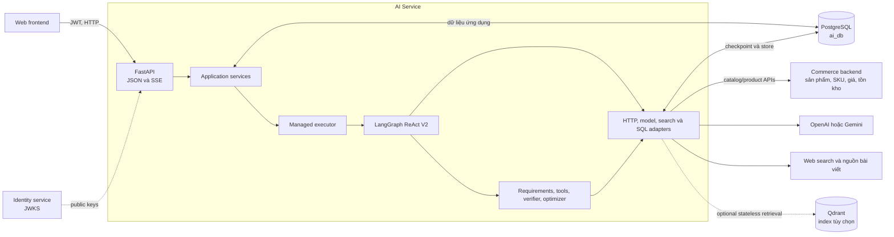
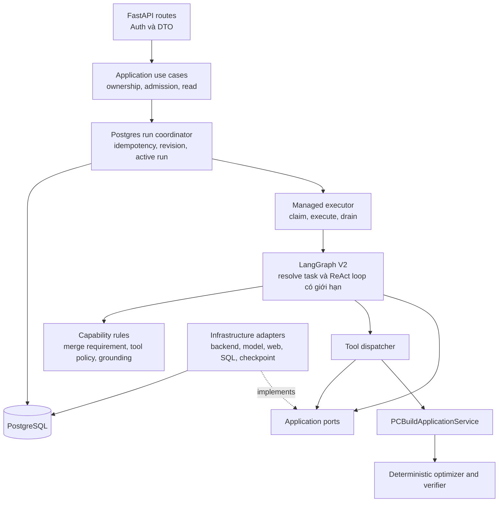
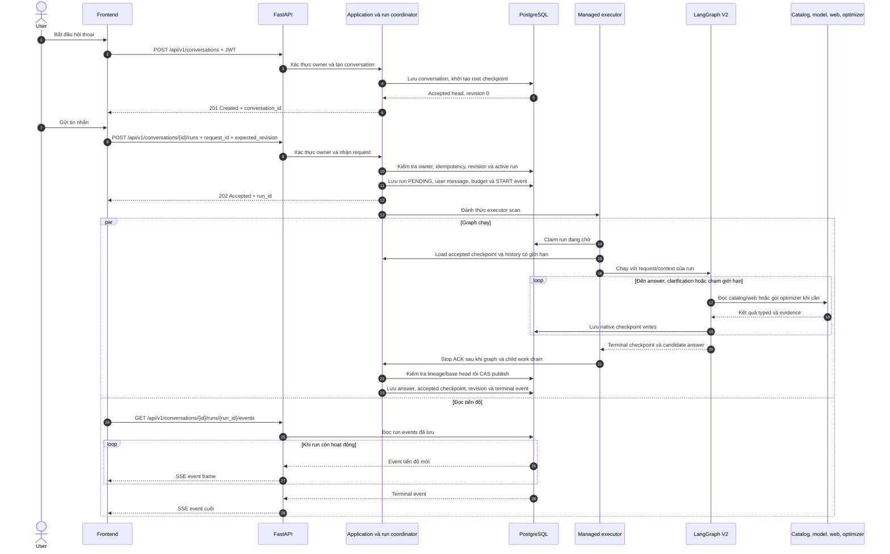
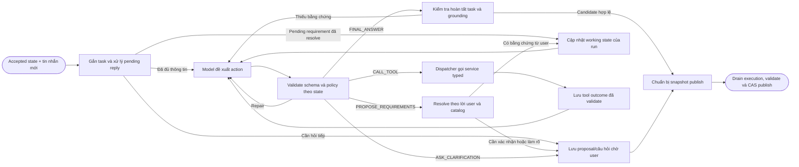

# Kiến trúc AI Service

AI Service nhận yêu cầu, tra cứu catalog và tư vấn hoặc build PC. Backend thương
mại sở hữu dữ liệu sản phẩm/tồn kho; AI Service sở hữu hội thoại và trạng thái đã
chấp nhận; optimizer xếp hạng cấu hình theo thuật toán xác định.

## Ranh giới hệ thống



Mũi tên ở sơ đồ này thể hiện tích hợp lúc chạy, không phải hướng import giữa các
layer. Sơ đồ bên dưới tách rõ luồng gọi và chiều hiện thực port/adapter.

Hai nhánh PostgreSQL có chủ sở hữu riêng: bảng ứng dụng lưu conversation, run,
message và event; LangGraph checkpointer lưu checkpoint thực thi. Qdrant là index
phái sinh tùy chọn, không quyết định visibility/giá/tồn kho hiện tại và không lưu
conversation của Stateful ReAct V2.

| Hệ thống | Sở hữu | AI Service dùng để |
| --- | --- | --- |
| Identity service | Account và signing keys | Xác minh access token qua JWKS |
| Commerce backend | Catalog active, SKU, giá và tồn kho | Tra cứu sản phẩm và dữ liệu linh kiện |
| AI Service | Conversation, run, requirements và kết quả đã chấp nhận | Điều phối hội thoại và API AI |
| Model provider | Model inference | Hiểu yêu cầu, chọn action được phép, giải thích evidence |
| Web sources | Nội dung trang ngoài | Bổ sung thông tin có nguồn và trạng thái trích xuất |
| PostgreSQL | Bản ghi AI và checkpoint LangGraph | Lưu state, execution và tiến độ bền vững |

AI Service gọi backend qua HTTP adapter, không đọc trực tiếp database thương mại.
Model chỉ đề xuất action; application xác minh trước khi áp dụng requirement hay
công bố state hội thoại.

## Các thành phần bên trong



Mũi tên liền thể hiện luồng gọi lúc chạy; mũi tên chấm thể hiện adapter hiện thực
port. Application/capability chỉ phụ thuộc contract; composition root inject
adapter khi khởi động. Helper legacy cũng nhận port bắt buộc: `WebSearchTools(search_client)`,
`ShoppingAssistantTools(commerce_client)`, `PCBuilderTools(rule_engine)`.
Không tự tạo HTTP/search/hardware adapter trong capability. Test kiến trúc chặn
import infrastructure và runtime framework vào hai tầng bên trong.

### API — nhận request và trả response

`api/` xác thực access token, validate DTO và chuyển request sang application use
case. Run API chỉ nhận yêu cầu bền vững rồi trả `202`; SSE đọc event đã lưu, không
chạy graph trong HTTP handler.

### Application use cases — điều phối nghiệp vụ ứng dụng

`application/use_cases/` thực hiện các ca sử dụng như tạo conversation, gửi/hủy
run, đọc trạng thái và lịch sử. Lớp này gọi qua port; nó không phụ thuộc trực tiếp
vào SDK model, SQL hay API cụ thể của LangGraph.

### Run coordinator — admission và publication

`PostgresRunCoordinator` ghi run cùng điều kiện chạy/publish: `request_id` lặp không
tạo run trùng, mỗi conversation chỉ có một run đang chạy, và mỗi run giữ revision
cùng checkpoint gốc. Accepted checkpoint là snapshot hội thoại đang được công bố.
Khi run kết thúc, coordinator chỉ cập nhật snapshot nếu revision/head vẫn khớp base
(compare-and-swap); checkpoint cuối phải thuộc chuỗi checkpoint phát sinh từ base.
Đây là nguồn chuẩn cho trạng thái được công bố.

### Managed executor — sở hữu vòng đời execution

`ManagedExecutor` nhận các run đã lưu để xử lý, chạy graph trong task group có quản
lý, theo dõi heartbeat, nhận cancel và chờ các graph/tool call con kết thúc. Nó chỉ
phát stop ACK (xác nhận execution đã dừng) sau khi mọi tác vụ con đã dừng; mất kết
nối SSE không ảnh hưởng graph.

### LangGraph — điều phối một lượt ReAct

Graph bắt đầu từ accepted checkpoint của conversation, xử lý lượt mới và chạy vòng
lặp có giới hạn số lần gọi model/tool và thời gian: bind task/pending reply → model
chọn action → validate → gọi tool, đề xuất sửa requirement hoặc trả lời. Checkpoint
lưu tiến trình để recovery; graph không tự quyết checkpoint nào được publish.

### Requirements — chuyển lời người dùng thành constraint có nghĩa

`capabilities/assistant/requirements/` chạy khi agent đề xuất đổi requirements
hoặc khi user trả lời một requirement/confirmation đang chờ; câu hỏi đọc/tra cứu
không bị ép qua pipeline này. Nó resolve tên linh kiện/đơn vị bằng catalog, áp
thay đổi có bằng chứng từ lời user vào **working state**, hoặc giữ proposal do agent
tạo ở trạng thái chờ user xác nhận. Compiler chuyển working state thành optimizer
input; verifier đối chiếu kết quả với yêu cầu. Accepted state chỉ đổi khi coordinator
publish thành công. Model không được âm thầm thêm hoặc nới constraint.

Budget/workload, capacity/unit và CLEAR có thể xử lý trước hardware I/O. Catalog
được tải khi cần resolve SKU hoặc khi BUILD đã đủ prerequisite; sau merge, graph
kiểm tra lại điều kiện này. Chưa tải candidates không chứng minh thiếu metadata.

### ReAct capability — chọn hành động trong giới hạn

`capabilities/assistant/react/` định nghĩa action/tool contracts, tool policy theo
state, execution outcome và kiểm tra câu trả lời đã hoàn tất task, có evidence phù
hợp hay chưa (grounding). Model đề xuất hành động; capability kiểm tra điều kiện
và giữ tool result có schema trong ledger.

### Tool dispatcher — nối action với năng lực hệ thống

`ToolDispatcher` validate tên tool, arguments và context rồi gọi catalog, web
search/read hoặc PC build service. Kết quả trả về theo schema typed; model không
được truyền ID tùy ý để thay thế canonical catalog lookup.

### PC build service và optimizer — tính cấu hình xác định

`PCBuildApplicationService` nhận optimizer constraints cùng catalog candidates,
gọi optimizer và áp recommendation policy. Optimizer xử lý compatibility, pruning
và scoring mà không gọi network, database hay model; verifier riêng kiểm tra yêu
cầu được thỏa mãn. “Chưa tìm thấy” không tự động có nghĩa là “không tồn tại”.

### Ports, adapters và composition root — biên I/O

`application/ports/` định nghĩa giao diện cho model, catalog, web, persistence và
graph runner. `infrastructure/` hiện thực các giao diện đó bằng HTTP clients,
provider adapters, PostgreSQL/checkpointer và search adapters. Composition root
ghép implementation khi khởi động; adapter làm I/O, không sở hữu business rules.

### Hai loại persistence — dữ liệu ứng dụng và graph

PostgreSQL application tables là nguồn chuẩn cho owner, run, message, event, budget
và accepted head. LangGraph saver lưu execution state, lineage và pending writes.
Hai bên dùng chung PostgreSQL nhưng có write path khác nhau; application không sửa
trực tiếp bảng nội bộ của checkpointer.

| Công nghệ | Vai trò |
| --- | --- |
| FastAPI | HTTP routes, OpenAPI và application lifespan |
| Pydantic | Validate request, tool, result và public-view contract |
| LangGraph | Điều phối flow stateful có giới hạn và checkpoint graph state |
| LangChain model adapters | Giao tiếp structured-output/tool protocol của từng provider |
| PostgreSQL | Lưu bản ghi ứng dụng và native graph checkpoint |

Request path chỉ có một graph runtime là LangGraph; không dùng PydanticAI.

## Một lượt hội thoại

Frontend tạo conversation một lần, sau đó gửi mỗi lượt user thành một run. Khi
tạo conversation, service ghi native root checkpoint và đặt nó làm accepted head
ban đầu. Run được ghi bền vững rồi trả `202`; HTTP handler không sở hữu graph task.



SSE chỉ đọc run events đã lưu. Ngắt kết nối không dừng executor; muốn hủy phải gọi
cancel endpoint. V2 `DELTA` chứa answer text đã validate, không chứa token thô của
provider. Xem [HTTP/SSE contract](../05-api/stateful-chat-v2.md). Có thể đọc trạng
thái bằng `GET /api/v1/conversations/{id}/runs/{run_id}`.

## Bên trong graph



Requirement resolution là một nhánh agent chọn, không phải prefix bắt buộc của
mọi câu hỏi. Graph chỉ expose tool phù hợp với task và state hiện tại. Với yêu cầu
build, application compile working requirements thành optimizer input; optimizer
xếp hạng cấu hình; verifier đối chiếu kết quả với yêu cầu gốc. Câu hỏi sản phẩm có
thể chỉ cần catalog evidence, không chạy optimizer.

`tool ledger` là execution record; model messages được dựng từ typed tool outcomes.
Model có thể diễn giải kết quả, nhưng application chỉ publish sau khi xác nhận đủ
evidence và task đã hoàn thành. Xem [agent/tools](../04-ai/agent-tools.md) và
[requirements](../04-ai/requirements.md).

## Conversation, run và checkpoint

Mỗi conversation ánh xạ vào một LangGraph `thread_id` ổn định. Nhiều run nối tiếp
checkpoint trên cùng thread. Application giữ accepted head riêng:

```text
Application tables                         LangGraph checkpointer
───────────────────                         ─────────────────────
conversation.revision                      thread_id = conversation_id
conversation.accepted_checkpoint_id ─────► cp-A → cp-B → cp-C
agent_runs.base/final checkpoint refs       accepted     working/orphan
published messages and run events
```

`accepted_checkpoint_id` trỏ tới state đã publish. Checkpoint mới hơn có thể thuộc
run chưa xong hoặc execution mồ côi; “checkpoint mới nhất” không tự trở thành state
công khai hay base của lượt chat kế tiếp.

| Bản ghi | Nguồn dữ liệu chuẩn cho |
| --- | --- |
| `conversations` | Owner, revision, active run, accepted checkpoint ref |
| `agent_runs` | Request identity, base/final ref, attempt và execution status |
| `conversation_messages` | User turn đã nhận và assistant reply đã publish |
| `agent_run_events` | Tiến độ bền vững và terminal event cho SSE |
| `agent_call_budgets` / `agent_call_attempts` | Giới hạn model/tool I/O bền vững theo run |
| LangGraph checkpointer | Graph state, checkpoint lineage và pending writes |

Application tables và native saver cùng dùng PostgreSQL nhưng có chủ sở hữu, write
path riêng. Application không sửa trực tiếp bảng nội bộ LangGraph. Xem
[stateful schema](../03-data/ai-stateful-schema.md).

## Vòng đời và an toàn execution

Managed executor hiện chạy cùng process AI Service trong FastAPI lifespan.
PostgreSQL lưu run đang chờ và điều phối claim; hiện chưa có worker service hay
message broker riêng.

```text
Startup: kiểm tra migration và saver → mở clients → chạy managed executor
Request: lưu run → executor claim → graph/checkpointer xử lý
Publish: graph drain → executor stop ACK → kiểm tra lineage → CAS accepted head
Shutdown: drain execution → đóng model, HTTP client và DB resources
```

Các invariant dưới đây bảo vệ thread dùng chung:

1. Mỗi conversation chỉ có tối đa một execution sở hữu thread tại một thời điểm.
2. Run status hoặc lease hết hạn không chứng minh graph cũ đã dừng.
3. Chỉ stop evidence đáng tin cậy mới cho phép coordinator nhả thread.
4. Trước publication, kiểm tra checkpoint lineage và base revision/head rồi mới
   CAS accepted checkpoint.
5. Run lỗi/hủy có thể để lại checkpoint; checkpoint đó không thành accepted state.

Executor drain graph work trước khi ghi stop evidence. Nếu không lưu được evidence,
conversation vẫn bận để tránh takeover chỉ dựa vào heartbeat timeout. Xem
[state và recovery](../04-ai/context-management.md).

## Bắt đầu từ mã nguồn

```text
ai_service/
├── api/                    HTTP routes, auth dependencies, SSE encoding
├── application/            Use case và port
├── capabilities/
│   ├── assistant/          Requirements, ReAct actions/tools, grounding/publication
│   └── pc_builder/         Build service, compatibility, optimizer và scoring
└── infrastructure/
    ├── execution/          Managed executor và tạo graph cho từng run
    ├── graph/              LangGraph flow và checkpoint adapter
    ├── persistence/        PostgreSQL stores, coordinator, events, budgets
    ├── providers/          OpenAI/Gemini adapters
    ├── commerce/           Backend catalog/product clients
    └── search/             Web search, trích xuất trang và source templates
```

| Phần cần đọc | Mã nguồn |
| --- | --- |
| FastAPI routes/lifespan | [main.py](../../ai-service/src/ai_service/main.py), [stateful API](../../ai-service/src/ai_service/api/stateful_conversations.py) |
| Stateful resources | [stateful.py](../../ai-service/src/ai_service/infrastructure/stateful.py) |
| Executor và graph factory | [build runtime](../../ai-service/src/ai_service/infrastructure/execution/build_runtime.py), [supervisor](../../ai-service/src/ai_service/infrastructure/execution/supervisor.py) |
| ReAct graph | [flexible.py](../../ai-service/src/ai_service/infrastructure/graph/flexible.py) |
| Nhận run và publication | [runs.py](../../ai-service/src/ai_service/infrastructure/persistence/runs.py) |
| Tool policy/dispatcher | [react/tools.py](../../ai-service/src/ai_service/capabilities/assistant/react/tools.py) |
| Requirements/verifier | [requirements/](../../ai-service/src/ai_service/capabilities/assistant/requirements/) |
| Catalog acquisition/clarification policy | [catalog_policy.py](../../ai-service/src/ai_service/capabilities/assistant/requirements/catalog_policy.py) |
| Optimizer | [pc_builder/](../../ai-service/src/ai_service/capabilities/pc_builder/) |

## Phạm vi hiện tại

Server và frontend chỉ chạy Stateful ReAct V2; startup bắt buộc DB/JWKS/model/mapping,
không còn cờ chọn V1/guided hoặc legacy chat endpoints. Product visibility lấy từ
backend. Soft-preference scoring, mở rộng web sources, retention jobs, xóa
conversation, replay và lịch sử customer nâng cao được theo dõi trong
[implementation status](../04-ai/stateful-implementation-status.md).

**Đọc tiếp:** [Chạy local](../04-ai/getting-started.md) ·
[Cấu hình](../04-ai/configuration.md) · [AI manual](../04-ai/README.md).
Quyết định kiến trúc: [ADR-005](decisions/ADR-005-stateful-react.md).
