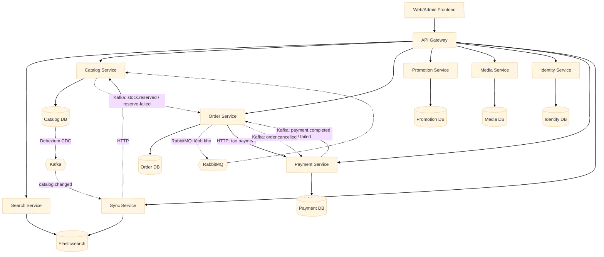
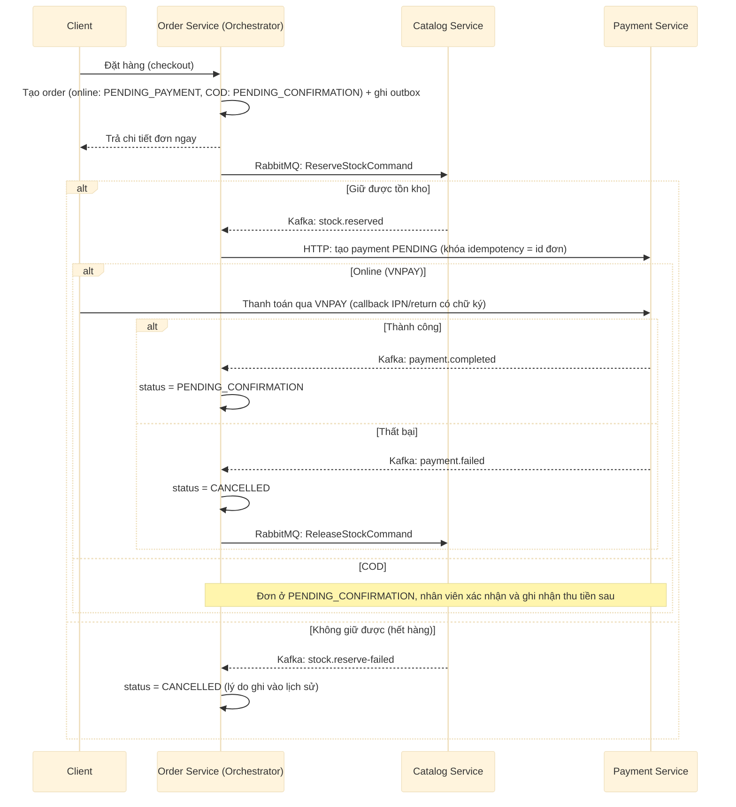
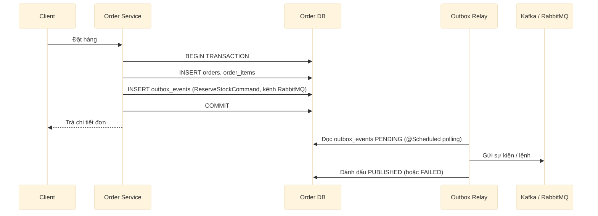

# Giao tiếp giữa các Service

Bổ sung cho [system-architecture.md](system-architecture.md): tài liệu này mô tả **cụ thể** service nào gọi service nào, theo use-case nào, bằng giao thức gì (HTTP, Kafka, RabbitMQ) và lý do chọn.

## Sơ đồ giao tiếp giữa các service

## Bảng use case → giao tiếp

| # | Use case | Caller → Callee | Giao thức | Lý do |
|---|---|---|---|---|
| 1 | Duyệt/tìm kiếm sản phẩm | Client → Search Service (có từ khóa) hoặc Catalog Service (không từ khóa) | HTTP | Read-heavy, public-facing, cần latency thấp cho UI |
| 2 | Xem chi tiết sản phẩm | Client → Catalog Service | HTTP | Public-facing |
| 3 | Thêm vào giỏ hàng | Order Service → Catalog Service | HTTP | Nội bộ, cần xác thực variant còn bán được và tồn kho ngay trong request |
| 4 | Tính khuyến mãi lúc đặt hàng | Order Service → Promotion Service | HTTP | Phải trả về số tiền chính xác ngay lập tức cho khách, không chấp nhận eventual consistency với tiền |
| 5 | Đặt hàng: giữ tồn kho | Order Service → (Outbox) → RabbitMQ `catalog.stock-commands` (`ReserveStockCommand`) → Catalog Service | RabbitMQ (outbox/inbox) | Lệnh chỉ giao cho **đúng một nơi xử lý** (Catalog); lỗi tạm thời thì retry rồi rơi vào DLQ, không chặn lệnh của đơn khác |
| 6 | Kết quả giữ tồn kho | Catalog Service → (Outbox) → Kafka `stock.reserved` / `stock.reserve-failed` → Order Service | Kafka (outbox/inbox) | Order Service là orchestrator, cần biết kết quả để quyết định bước tiếp theo |
| 7 | Tạo payment cho đơn | Order Service → Payment Service | HTTP | Chỉ gọi sau khi giữ được tồn kho; khóa idempotency là id đơn nên gọi lại không tạo payment thứ hai |
| 8 | Callback kết quả thanh toán VNPAY | VNPAY → Payment Service (IPN) và Client → Payment Service (return) | HTTP (có chữ ký) | Bên thứ ba chủ động gọi vào; cả hai đường dùng chung một hàm xử lý nên gọi lặp không sao |
| 9 | Kết quả thanh toán | Payment Service → (Outbox) → Kafka `payment.completed` / `payment.failed` → Order Service | Kafka (outbox/inbox) | Order cập nhật trạng thái đơn; nếu thất bại thì hủy đơn và gửi lệnh trả tồn kho |
| 10 | Trả tồn kho | Order Service → (Outbox) → RabbitMQ `catalog.stock-commands` (`ReleaseStockCommand`) → Catalog Service | RabbitMQ (outbox/inbox) | Cùng lý do #5; trả đúng phần tồn kho đơn đang giữ |
| 11 | Hủy đơn | Order Service → (Outbox) → Kafka `order.cancelled` → Payment Service | Kafka (outbox/inbox) | Payment chuyển các payment `PENDING` của đơn sang `CANCELLED`; payment đã `PAID` giữ nguyên để hoàn tiền thủ công |
| 12 | Viết đánh giá sản phẩm | Catalog Service → Order Service | HTTP | Cần xác thực ngay order item thuộc khách và đơn đã `COMPLETED` trước khi ghi review |
| 13 | Hiển thị tên người đánh giá, chi tiết khách | Catalog Service / Order Service → Identity Service | HTTP | Lấy tên hiện tại của khách; lỗi thì báo lỗi chứ không trả dữ liệu thiếu |
| 14 | Kiểm tra file ảnh khi lưu | Catalog Service / Identity Service → Media Service | HTTP | Chỉ lưu `file_id` đã tồn tại ở Media Service |
| 15 | Đồng bộ Catalog → Search | Catalog DB → Debezium CDC → Kafka `catalog.changed` → Sync Service → Catalog Service → Elasticsearch | Kafka (CDC) + HTTP | Catalog không phải tự publish event; không bỏ sót thay đổi nào (giải quyết dual-write). Search Service chỉ đọc Elasticsearch |
| 16 | Upload ảnh sản phẩm/avatar | Client → Media Service | HTTP | Upload là thao tác client-facing trực tiếp; các service khác chỉ lưu `file_id` client gửi kèm |

## Order Service — Saga Orchestrator

Đặt hàng là quy trình nhiều bước, xuyên nhiều service (Catalog giữ kho, Payment thu tiền), nên cần **saga** thay cho một transaction DB duy nhất. Có hai cách: **choreography** (các service tự lắng nghe event của nhau) hoặc **orchestration** (một service chủ động ra lệnh từng bước và quyết định bước tiếp theo).

Dự án này chọn **Order Service làm orchestrator**, vì:
- Order Service sở hữu `orders.status` — trạng thái toàn bộ vòng đời đơn — nên là nơi hợp lý nhất để quyết định "bước tiếp theo là gì".
- Nếu Catalog và Payment tự phản ứng song song với cùng một event (choreography thuần), logic quyết định "khi nào xác nhận/hủy đơn" bị **rải rác** ở nhiều service, khó trace khi có lỗi.
- Orchestration tập trung điều phối vào một chỗ — dễ debug, dễ thêm bước mới mà không sửa Catalog/Payment.

### Sơ đồ điều phối đặt hàng

Order Service **chủ động gọi từng bước theo thứ tự** (giữ tồn kho trước, có kho mới tạo payment) và **tự quyết định bước tiếp theo dựa trên kết quả nhận về**; Catalog/Payment không tự phản ứng với một event chung của đơn hàng. Hủy đơn (khách, nhân viên hoặc hệ thống) cũng do Order Service điều phối: chuyển `CANCELLED`, gửi lệnh trả tồn kho và phát `order.cancelled` để Payment hủy payment `PENDING`.

## Outbox pattern (bên publish)

Áp dụng ở **Catalog Service**, **Order Service** và **Payment Service** — nơi một hành động nghiệp vụ *bắt buộc* đi kèm một sự kiện hoặc lệnh cho service khác.

**Vì sao cần outbox thay vì publish thẳng trong code?**
Nếu `INSERT orders` thành công nhưng lệnh gửi thất bại (mất mạng, service sập giữa chừng) → đơn tồn tại nhưng Catalog/Payment không biết để xử lý → đơn "treo" mãi. Ghi sự kiện vào bảng `outbox_events` **trong cùng transaction** với dữ liệu nghiệp vụ đảm bảo hai việc này atomic. Mỗi service có một relay tự viết (`OutboxRelay`, polling định kỳ bảng `outbox_events` theo `status = PENDING`) gửi sau, tách khỏi transaction nghiệp vụ; mỗi dòng ghi kênh (`KAFKA` hoặc `RABBITMQ`), đích và `trace_context` để nối vết xử lý. Debezium chỉ dùng cho luồng Catalog → Search, không dùng cho outbox.

## Inbox pattern (bên consume)

Áp dụng ở **Catalog Service** (nhận lệnh RabbitMQ), **Order Service** (nhận `stock.*`, `payment.*`) và **Payment Service** (nhận `order.cancelled`).

- Kafka/RabbitMQ đảm bảo **at-least-once delivery** — cùng một event có thể được gửi lại (consumer restart, rebalance...).
- Nếu Catalog xử lý cùng một lệnh giữ kho hai lần mà không kiểm tra, sẽ **trừ kho hai lần** cho một đơn → sai lệch tồn kho.
- Giải pháp: mỗi service consumer có bảng `inbox_events (event_id PRIMARY KEY, consumer_name, processed_at)`. Trước khi xử lý, insert `event_id` (khóa chính; `consumer_name` ghi consumer đã xử lý) trong cùng transaction với hành động nghiệp vụ; nếu đã tồn tại (do gửi lại) → bỏ qua.

Kết hợp Outbox (publisher) + Inbox (consumer) cho ra **xử lý đúng một lần về mặt nghiệp vụ**, dù tầng transport chỉ đảm bảo at-least-once.

## Đồng bộ Catalog → Elasticsearch: không để mất thay đổi

`sync-service` đọc `catalog.changed` rồi gọi lại Catalog Service để dựng document. Hai bên đều có thể tạm thời không dùng được (đặc biệt khi infra chạy trên server còn application chạy local), nên mỗi thay đổi được xử lý theo quy tắc sau, để PostgreSQL và Elasticsearch không lệch nhau mà không ai biết.

| Tình huống | Xử lý |
| --- | --- |
| Catalog hoặc Elasticsearch không dùng được | Retry vô hạn về số lần, giãn cách tăng dần 2s → 30s, tối đa 6 giờ cho một thay đổi. Offset không được commit trong lúc này |
| Hết 6 giờ mà vẫn lỗi | Chuyển sang `catalog.changed.DLT`, không bỏ |
| Thay đổi không đọc được (JSON hỏng, thiếu `id`, id sai) | Không retry, chuyển ngay sang `catalog.changed.DLT` |
| Ghi vào DLT lỗi | Offset không được commit, thay đổi tiếp tục được thử lại |

Khi có thay đổi vào DLT, service ghi log ERROR và tăng counter `sync.dlt.published` để đặt cảnh báo.

**Khôi phục** (đều chỉ dành cho ADMIN, có nút trên trang `/admin/search-index`):

- `GET /sync-service/products/sync/dlt`: số thay đổi đang chờ.
- `POST /sync-service/products/sync/dlt/replay?limit=100`: xử lý lại các thay đổi đã bị chuyển sang DLT, cũ nhất trước. Vị trí được nhớ giữa các lần gọi. Replay dừng ở thay đổi lỗi lại (`blocked=true`) để chạy lại sau khi sửa nguyên nhân. Thay đổi không đọc được được bỏ qua (`skipped`) và nằm trong topic cho tới khi hết retention.
- `POST /sync-service/products/sync`: dựng lại toàn bộ index từ Catalog, dùng khi DLT đã hết hạn hoặc không đủ.

**Retention:** `catalog.changed`, `catalog.changed.DLT` và committed offset của consumer group giữ 30 ngày (`docker-compose.yml`), nên application có thể offline tới đó mà vẫn bắt kịp. Topic đã tồn tại không tự đổi theo mặc định mới của broker, chạy `docker/kafka/set-retention.sh` một lần. Nếu Kafka Connect tắt lâu, replication slot của Postgres giữ WAL tăng dần, cần theo dõi dung lượng.
