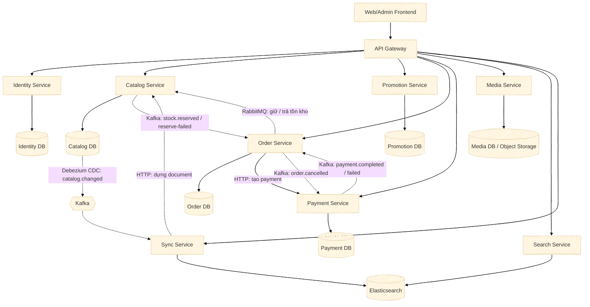

# System Architecture — Microservices

Chi tiết từng luồng nằm ở [service-communication.md](service-communication.md).

## Service và phạm vi (scope)

| Service | Scope |
|---|---|
| **Identity Service** | Xác thực (mật khẩu, Google), tài khoản, vai trò, hồ sơ quản trị viên/nhân viên/khách hàng, địa chỉ giao hàng |
| **Catalog Service** | Loại phần cứng, thương hiệu, danh mục, thuộc tính, sản phẩm, biến thể, tồn kho, ảnh, option, đánh giá sản phẩm; phát lệnh/sự kiện kho qua outbox |
| **Promotion Service** | Khuyến mãi theo đơn, mọi dòng hàng hoặc danh mục (voucher có mã hoặc tự động) |
| **Order Service** | Giỏ hàng (mỗi khách một giỏ), đơn hàng, dòng đơn hàng, lịch sử trạng thái, phương thức vận chuyển; điều phối saga đặt hàng |
| **Payment Service** | Phương thức thanh toán (COD, VNPAY), giao dịch thanh toán, callback VNPAY |
| **Media Service** | Lưu trữ và phục vụ file (ảnh sản phẩm, avatar, logo...) |
| **Search Service** | Tìm kiếm/lọc sản phẩm trên Elasticsearch |
| **Sync Service** | Đọc `catalog.changed` (CDC của Catalog DB) và dựng lại document trong Elasticsearch; không có bảng riêng |

Mỗi service có database riêng; khóa ngoại giữa các service chỉ là tham chiếu logic, không có FK ở DB. Bảng `outbox_events` và `inbox_events` có ở Catalog, Order và Payment (xem service-communication.md).
